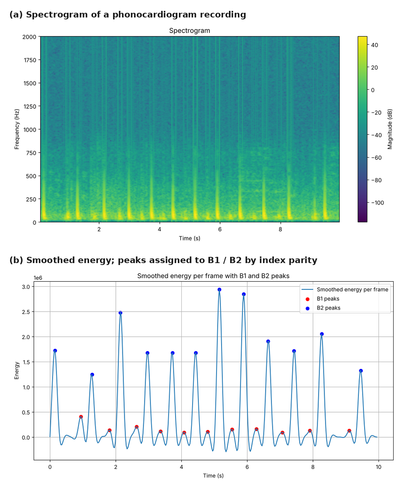

# Phonocardiogram Signal Analysis

Pipeline that locates the first and second heart sounds (B1, B2) in digital stethoscope recordings and compares signal energy across the phases of the cardiac cycle.

<p align="center">
  
</p>

> **Status.** Exploratory analysis written in 2024, not actively maintained. There are no reference annotations, so the accuracy of the B1/B2 detection has **not** been measured and no clinical conclusion should be drawn from the outputs.

> **Context.** Developed in 2024 during my engineering studies at [ESEO](https://www.eseo.fr), within study and research projects carried out in collaboration with ESEO. Exploratory scope: this is not a clinical study and makes no claim of clinical validity.

| | |
|---|---|
| **Input** | 31 stereo WAV recordings exported from a digital stethoscope (`data/recordings/`). |
| **Output** | Positions of energy peaks labelled B1 / B2, and mean squared energy in four phases of each cardiac cycle (B2, diastole, B1, systole). |
| **Evaluation** | None (no reference B1/B2 positions). |
| **Code** | Python notebook, NumPy / SciPy / Matplotlib. |

## Overview

Each stereo recording is converted to a complex signal, band-pass filtered and turned into a smoothed short-time energy trace. Peaks of this trace are taken as heart sounds, and the mean squared energy is computed in four phases of the cardiac cycle.

## Method

All steps are in [`notebooks/phonocardiogram_analysis.ipynb`](notebooks/phonocardiogram_analysis.ipynb).

1. Load a WAV file and display it in the time domain.
2. Frequency spectrum and spectrogram of one frame.
3. Normalisation by the maximum absolute value, then Butterworth band-pass filtering.
4. Short-time energy per frame (Hamming window, FFT based).
5. Low-pass smoothing of the energy trace and peak detection with adaptive parameters.
6. Inter-peak intervals. The detected peaks are split into two alternating series by index parity, labelled B1 and B2, starting from the pair with the shortest interval. This assumes that no peak is missed or spurious.
7. Margin of one frame around each B1 / B2 peak.
8. Mean squared energy in four phases: B2 group, diastole, B1 group, systole.
9. The same pipeline on every recording, with per-recording bar charts.

## Results (notebook outputs)

- Example recording (`ad apex 1`): the 22 intervals between the first 23 detected peaks range from 0.33 s to 0.84 s with a median of 0.36 s. Most intervals are close to 0.36 s, so they are nearly uniform rather than alternating between a short (systole) and a long (diastole) interval. This makes the index-parity assignment of B1 and B2 doubtful for this recording.
- Per-cycle mean squared energies are highly variable. Over the 11 cycles of this recording the B2 value ranges from about 27 to about 2.9e4 (arbitrary units), the first cycle being an extreme value. No stable energy ratio between phases is established.
- The all-recordings summary is on a different scale (about 1e-2) from the single-recording example (about 1e1 to 1e4). Compare values only within one section.

## Limitations

- No ground truth for B1/B2 positions, and no evaluation against clinical findings.
- B1/B2 labelling relies on strict alternation of the detected peaks, which the intervals above do not clearly support.
- Filter cut-offs and detection parameters are set by hand in the notebook.

## Repository structure

```
notebooks/phonocardiogram_analysis.ipynb   analysis notebook
data/recordings/                           31 WAV recordings
data/README.md                             data description
assets/overview.png                        figure above (from the notebook outputs)
requirements.txt
CITATION.cff
LICENSE
```

## Reproducing

```bash
python -m venv .venv && source .venv/bin/activate
pip install -r requirements.txt
cd notebooks && jupyter lab        # open phonocardiogram_analysis.ipynb and run all cells
```

The notebook was re-executed end to end (no errors) with Python 3.13, NumPy 2.5.3, SciPy 1.18.1 and Matplotlib 3.11.2, and reproduced the numeric outputs of the original 2024 run (peak lists, B1 / B2 indices). Window functions are imported from `scipy.signal.windows`, because `hamming` and `kaiser` were removed from `scipy.signal` in recent SciPy releases. File paths use `/`, so the notebook also runs on Linux and macOS.

## Citation and licence

See [`CITATION.cff`](CITATION.cff). Code released under the [MIT licence](LICENSE). The recordings are not covered by this licence (see [`data/README.md`](data/README.md)).

Author: Jean-Eudes Beucher
